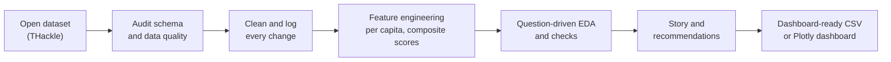
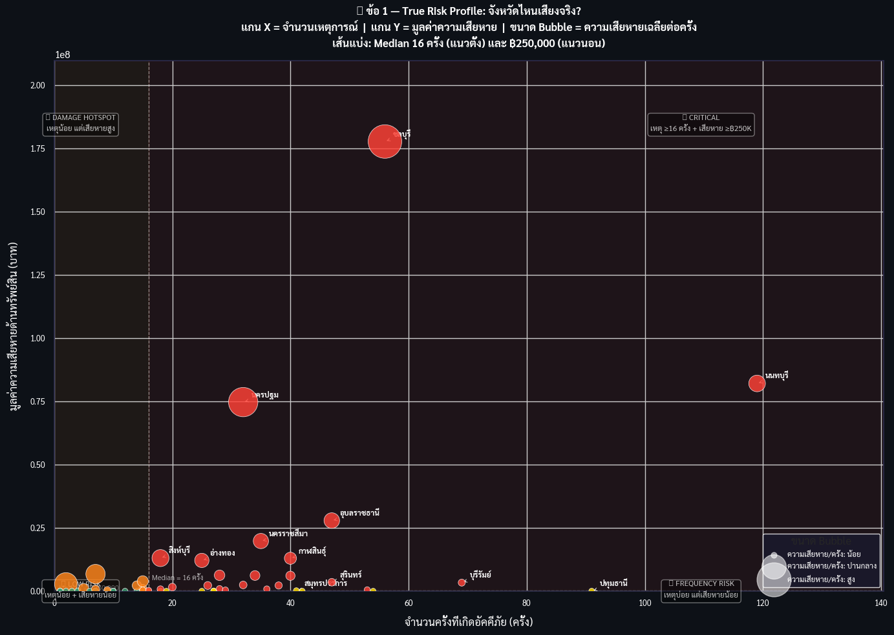
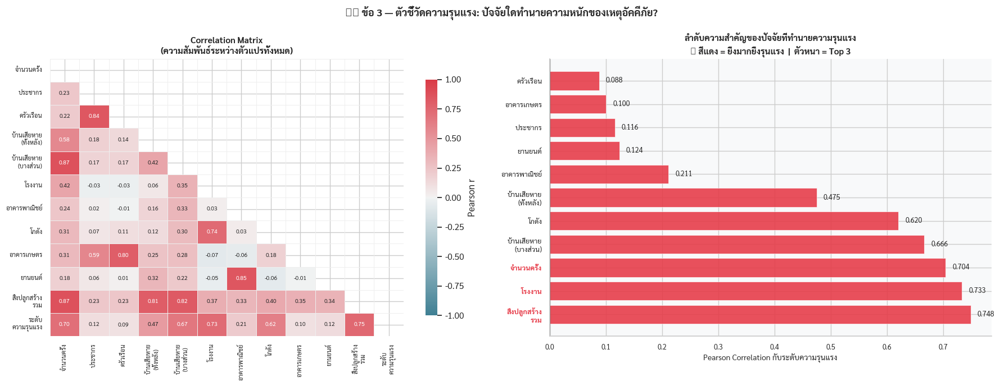
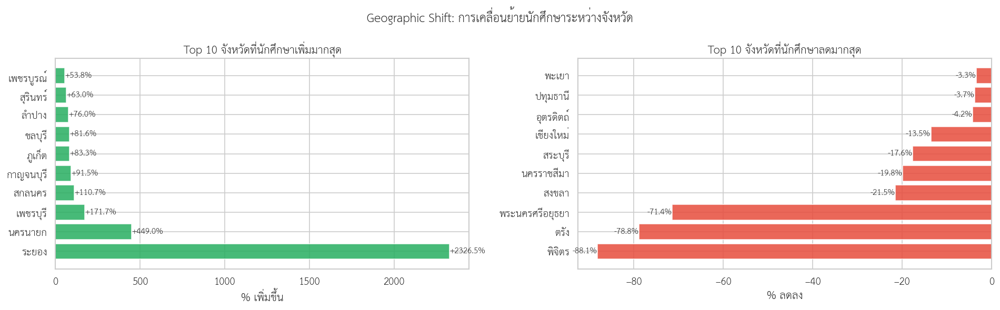
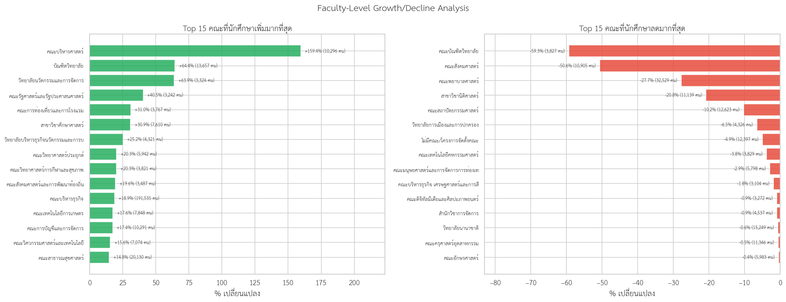

# Thai Open-Data Storytelling: Fire Risk, University Enrollment, Rain and Floods

Three **data-storytelling** notebooks from the Super AI Engineer Season 6 mini-hackathon (March 2026). Each takes a Thai open dataset from [THackle](https://www.thackle.or.th) and turns it into a question-driven story with a clear recommendation. Notebook text is in Thai; this page summarizes the findings in English.

| Notebook | Data | Question | Headline |
|---|---|---|---|
| [`01_fire_statistics_2562`](notebooks/01_fire_statistics_2562.ipynb) | Fires by province, 2019 (B.E. 2562), Dept. of Disaster Prevention and Mitigation | Which provinces are *really* at risk, and what predicts severity? | 23 provinces are critical; factories are the strongest "multiplier" of damage (r = 0.73) |
| [`02_university_students_2567_2568`](notebooks/02_university_students_2567_2568.ipynb) | Students in Thai higher education, 2024 and 2025 | Who is growing, who is shrinking, and where? | +5.3% overall, but private universities +21% while some leading public ones shrink |
| [`03_rainfall_and_flood_risk`](notebooks/03_rainfall_and_flood_risk.ipynb) | Monthly rainfall (HII) and flood-risk areas by tambon | How do rain and recurring flood risk line up? | High-risk tambons peak in Oct to Nov; rain explains little of it (r = 0.20) |

[1 Fire risk](#1-fire-risk-in-thailand-2019) · [2 Enrollment](#2-who-studies-where-thai-universities-2024-vs-2025) · [3 Rain and floods](#3-rain-and-recurring-floods) · [Run](#run)

## 1. Fire risk in Thailand, 2019

Province-level data with 34 variables; after removing the total and footer rows that came with the file, 65 provinces remain.

- **True risk profile.** Incident count alone misleads, so provinces are placed on a frequency x damage plane split at the medians (16 incidents, 250,000 baht per incident) into *critical*, *damage hotspot*, *frequency risk* and *low risk*.
- **Where damage concentrates.** The eastern region takes about 38% of all damage although fewer buildings are damaged there than in the northeast: factory buildings in the eastern industrial zone are far more valuable per unit.
- **What predicts severity.** Factories (r = 0.73), total structures (0.75) and incident count (0.70) correlate most with a composite severity score (50% damage value, 30% casualties, 20% structures).
- **Fire-station need (bonus).** Nonthaburi carries 19.8 incidents per district, the highest in the country (one station per district as a proxy).
- **Recommendation (tiered).** Invest first in critical provinces, then damage hotspots such as industrial zones (inspection and sprinkler rules), then frequency-risk areas; use "structures plus factories" as an early-warning trigger.

<table>
<tr>
<td align="center"><b>True risk profile</b> </td>
<td align="center"><b>What correlates with severity</b> </td>
</tr>
</table>

*Caveats.* One year of data and no response times. The severity score already contains the structure count (20%) and the damage value (50%), so its correlation with structures is partly built in; the factory correlation is not. Everything is province-level correlation, not causation (the notebook says so too). The scope text mentions 72 provinces while the analysis uses 65.

## 2. Who studies where: Thai universities, 2024 vs 2025

Two yearly files: 1,899,470 students in 2024 and 2,000,559 in 2025; in 2024, 159 universities, 518 faculties and 2,843 programs. The 2024 file has no province column, so provinces are mapped from the 2025 file (100% coverage); the audit and cleaning steps are logged (12 rows removed in total).

- Private universities grew about 21% while some top public ones shrank; Chonburi grew while Chiang Mai and Songkhla shrank.
- Women are 59% of students but 91% in nursing and 1% in automotive programs; nursing faculties lost 27%.
- Most provinces have a single institution (high Herfindahl-Hirschman concentration).
- A six-panel Plotly dashboard and summary tables are prepared for BI tools.

<table>
<tr>
<td align="center"><b>Geographic shift</b> </td>
<td align="center"><b>Faculty-level change</b> </td>
</tr>
</table>

*Caveats.* Provincial changes such as +2,327% (Rayong) or -88% (Phichit) while the total grows 5.3% look like reporting or classification artifacts between the two files rather than real student movement. The faculty chart lists the same kind of unit (for example the graduate school) as both a big gain and a big loss because names are not harmonized. The notebook reports these as findings without checking them.

## 3. Rain and recurring floods

Monthly rainfall by province (77 provinces, 7,546 rows, 2018 to early 2026) from the Hydro-Informatics Institute, and flood-risk areas by tambon (27,023 rows, 6,435 tambons, with the number of floods in the last 17 years). Names were normalized against a province reference file before joining.

- Rainfall peaks in September (283 mm per month on average) and is lowest in January (23 mm). Trat is the wettest province and Suphan Buri the driest in the data; the south has the highest average (204 mm).
- 1,445 tambons are high risk (flooded 9 to 17 times in 17 years); Phra Nakhon Si Ayutthaya has the most (158). October has by far the most (1,177, then September 580 and November 307).
- Rainfall and risk score correlate only weakly (r = 0.20), so drainage, slope and land use matter.
- The notebook exports two clean CSVs for a Looker Studio dashboard.

*Caveats.* 7,546 rows = 77 provinces x 98 months, so 2026 holds only January and February and "2026 is the driest year" is a partial-year artifact. Rain is province-level and risk is tambon-level, so the correlation compares different granularities.

## Run

Open a notebook in Google Colab, then put the data where its first cells expect it ([`data/README.md`](data/README.md)):

 01 fire statistics  
 02 university students  
 03 rainfall and flood risk

Only the fire dataset is stored here; [`data/README.md`](data/README.md) lists the sources of the other two. Notebook paths are Colab paths, libraries are in `requirements.txt`, and `notebooks/archive/` holds an earlier save of notebook 01. The organizers' slides are not included. Competition notebooks, not a packaged project. [MIT](LICENSE) for the notebooks and write-up; the data keeps the terms of its source.
